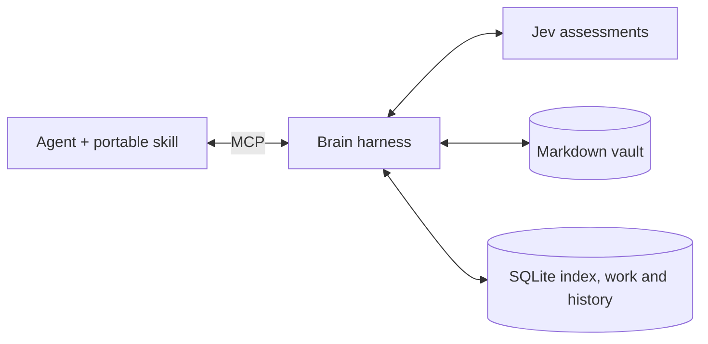

# Brain harness

Any owner-authorized MCP client can consume, capture, review and promote verified knowledge. Agents supply reasoning, duplicate checks and source verification. Enabled new/update writes save directly; the server applies write rules and records outcomes. Jev provides synchronous advisory quality/lifecycle feedback through `assess_memory`; agents choose and commit the final update. Jev also assesses recall and connection suggestions.



The server exposes `brain_status`, `search`, `recall`, `inspect`, `assess_memory`, `remember`, `undo_memory`, `list_work`, `claim_work`, `finish_work`, `review_memory`, `promote`, `suggest_connections` and `review_connection`. Existing recall/inspect/remember callers continue to work. The authoritative workflow is [the agent guide](agent-guide.md), also served as `brain://guide`; vault-specific rules are `brain://policy`.

## Connect any compatible client

1. Deploy the Docker service with persistent storage and an HTTPS origin; see [hosting](#hosting).
2. Add `https://YOUR-HOST/mcp` to the client's remote MCP connectors. Complete the owner OAuth flow. Clients must support this service's streamable HTTP transport and OAuth, or a compatible user-configured adapter; having arbitrary MCP support alone is not sufficient.
3. Install the four focused skills from `skills/`, individually or as the `brain-workflows` plugin. Follow [installation and migration](skill-migration.md). Skills contain no owner-specific paths, keys or tool prefixes. Tool-only clients can inspect canonical policy files without resources or prompts.
4. Ask the agent to discover status, search and inspect a note, then submit a sourced test proposal. Use synthetic data in an isolated test vault before granting live write access.

## How work scales

SQLite FTS5 provides bounded lexical retrieval. The persisted index reuses parsed Markdown when the file's inode, size and modification/change timestamps are unchanged. Refresh still reconciles filesystem metadata and links across the vault; this release is not an event-only index or a guarantee of constant-time refresh. A restart reuses the parsed index. No external embedding or queue service is required.

Interrupted assessments, Inbox items, changed observed notes and actionable legacy proposals produce deduplicated work. Normal direct capture does not require a later promotion. Genuine evidence/routing uncertainty uses Inbox; an interrupted staged candidate stays in assessment work without another copy. A five-minute claim belongs to the full authenticated client identity; claim tokens are omitted from listings. Expired workers cannot finish or review a reassigned job. New revisions invalidate old work, and source gaps can be deferred instead of reviewed every night. Original source collectors retain their own queues and budgets. The existing authorized sweep consumes a bounded ready batch, reuses stored advice and defers inaccessible evidence; live claims and future deferrals are skipped. No new server cron is added. See the [agent guide](agent-guide.md) and [review procedure](../skills/brain-review/SKILL.md); a tested protocol does not prove a real scheduler ran.

Promotion is an explicit Inbox-to-existing-folder operation, not bulk reorganization. A journal retains the original note and writes the destination before removing the source. Existing destination files and changed source revisions are never intentionally overwritten. Moves that break or retarget resolved links are held with affected paths. Correct outgoing links in the proposal; broader link repair needs its own authorized work. The server copy has exactly one writer and serialized sync; concurrent independent direct filesystem writers are unsupported.

The browser’s Review view prominently displays real advisory scores, recommendations, agent rationale and actual write status, including earlier-draft/context labels and unavailable advice. Shared work distinguishes saved Inbox notes from unsaved assessments. Bounded Undo restores a recorded prior state only when content, paths and incoming links remain safe. Legacy retained proposals can still be saved or dismissed. Owner review can close an active agent claim. Memory acceptance writes directly without rerunning Jev and preserves revision and privacy checks. A successful server write is separate from successful device sync.

## Hosting

Choose a managed platform appropriate to the owner. The existing deployment is recorded in the [hosting runbook](hosting-runbook.md). The same Docker image runs on Render, Railway or another platform supporting Node/Docker, an HTTPS proxy and a persistent writable volume.

For a standalone service, mount one volume at `/data`, run one replica, and set:

```dotenv
PUBLIC_ORIGIN=https://YOUR-HOST
BRAIN_OWNER_EMAIL=<approved Google account>
GOOGLE_CLIENT_ID=<Google web client ID>
GOOGLE_CLIENT_SECRET=<server-only secret>
BETTER_AUTH_SECRET=<random 32-byte secret>
JEV_API_KEY=<server-only secret>
JEV_MODEL=jev-1.14.0
AUTO_ACCEPT=
VAULT_PATH=/data/vault
STATE_PATH=/data/state
XDG_CONFIG_HOME=/data/config
SYNC_ENABLED=false
```

Configure the platform's port/proxy for the container's `PORT` (default 3000), health check `/healthz`, and a shutdown grace period of 150 seconds. Ensure the runtime `node` user can write the mounted volume. Do not put state on an ephemeral filesystem or run multiple replicas. Upload no `.env`, private evaluation dataset or desktop vault into the image.

Configure Google sign-in following [the setup guide](google-sso.md); store secrets through the hosting platform's environment UI. Follow README's separate-vault Obsidian Headless login/setup in the running service, then enable sync only after a successful manual sync. `/data/config` preserves its credentials on managed hosting. Local Compose explicitly retains `/home/node/.config` and the existing named home volume, preserving the current local login.

Direct hosting does not require `BRAIN_BRIDGE_KEY`. If retaining Vercel as the canonical frontend, configure the existing bridge on both sides with the same random secret and use the Vercel origin as `PUBLIC_ORIGIN`; never mix issuers. Bridge-enabled workers reject requests without the bridge secret. Remote access is not verified until the owner deploys the final origin and completes a real connector OAuth roundtrip.

## Migration and limits

The four-skill migration is approved. Eligible personal same-session new/update capture is active and verified; parent/log/index bookkeeping and existing collectors retain their selected local routes. See [writer activation](writer-activation.md). See [the migration record](skill-migration.md) for installed surfaces, exact pending targets and verification limits.

Keep `AUTO_ACCEPT` empty during validation. Enable only owner-approved actions after isolated write tests, backup and source/navigation/checkpoint checks. Empty acceptance does not disable explicit connection acceptance or queue mutations. Old retained proposals are not replayed automatically.

External-assessment exclusions and protected policy/operational paths remain enforced. Preserve explicitly retained local collectors, checkpoint routes and Obsidian integrations until replacements cover their existing behavior. Never turn a held MCP proposal into a direct filesystem retry.

When adopting a workflow, align canonical policy, stage routing, installed skills and the actual existing scheduler prompt. Preserve source boundaries, collector ownership, schedule times, budgets and read-only checks. Record inaccessible remote targets precisely; editing synced Markdown does not reconfigure a running agent.

Back up vault, SQLite and sync credentials before a runtime upgrade. The evaluator request ledger remains cumulative; this skill migration does not authorize a new paid evaluation sweep. Verify each selected client's OAuth and read calls independently, then synthetic capture/promotion in isolated state. Production writes and another device's sync require separate observed evidence.
