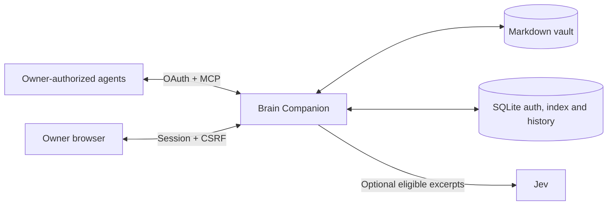

# Brain harness

One owner authorizes MCP clients to use one Markdown vault. Agents provide reasoning, source verification, duplicate checks, and final prose. The service applies permissions and records writes; an external model never grants authority.

The fourteen tools are `brain_status`, `search`, `recall`, `inspect`, `assess_memory`, `remember`, `undo_memory`, `list_work`, `claim_work`, `finish_work`, `review_memory`, `promote`, `suggest_connections`, and `review_connection`. The [agent guide](agent-guide.md) is also served as `brain://guide`. `brain://policy` exposes the owner's local policy files to authorized clients.

## Retrieval and external assessment

SQLite FTS5 supplies lexical search. The index reuses parsed notes using inode, size, and timestamps; refresh still reconciles filesystem metadata and links. There is no semantic embedding service. `search` and `inspect` are local operations. `recall` sends a bounded eligible shortlist and the query to Jev. Assessment and connection tools also make external requests; see [privacy boundaries](../SECURITY.md).

## Writes and shared work

`assess_memory` stores a candidate and advisory feedback without writing a note. The agent decides and commits using `remember`, an assessment reference/reason, a fresh revision, and a separate idempotency key. Direct `remember` remains supported without assessment. Jev failure does not veto an otherwise permitted commit.

Markdown is canonical. SQLite retains exact proposals, before/after text, sources, assessments, work claims, authentication state, and a write journal. It is private data, not just a disposable index. New/update/promote actions are separately enabled by `AUTO_ACCEPT`.

Writes and one-shot Obsidian sync share one queue. Updates use revision checks and atomic replacement; new files are published without replacing an existing destination. Exact retries return the original result. Interrupted writes are reconciled from the journal. The server copy supports one process and no independent filesystem writers; it is not a cross-process transaction system.

Inbox notes, changed observed notes, interrupted assessments, and retained proposals create bounded work items. Five-minute claims coordinate clients without granting new permissions. `finish_work` records an outcome, not a note write. Promotion files a claimed Inbox note into an existing Projects/Areas/Resources folder and checks link resolution. Undo reverses only a recorded operation when its current revision and links remain safe. Neither is a general filesystem API.

## Hosting and limits

Follow the [README setup](../README.md#deploy). Run one persistent service and use your own canonical HTTPS origin. The optional Vercel bridge forwards only selected routes and requires a shared secret on the backend. Browser sessions and OAuth grants remain required behind the bridge.

There is no tenant or per-folder isolation. All owner-authorized clients can read all indexed notes, including those excluded from Jev. Privacy labels control external assessment and capture routing, not client read access. Notes and external excerpts may contain prompt injection; clients must treat them as data.

Back up both vault and state, retain sync credentials privately, and verify restore separately. The app has no built-in scheduler for agent review, no off-host backup service, and no promise that a successful server write has already reached another device. Keep any owner-specific collectors, schedules, and operating records outside this repository.
