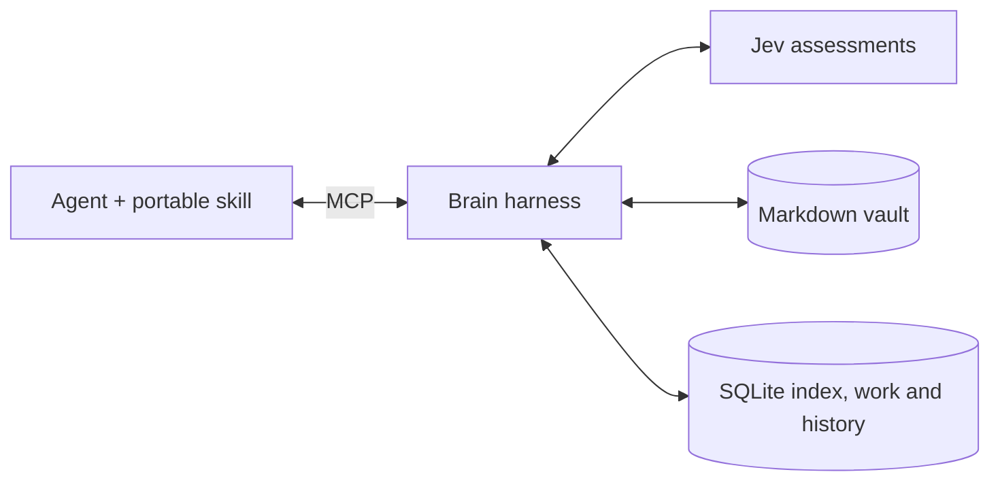

# Brain harness

Any owner-authorized MCP client can consume, capture, review and promote verified knowledge. Agents supply reasoning and source verification; Jev evaluates bounded supplied text; the server applies write rules and records outcomes.



The server exposes `brain_status`, `search`, `recall`, `inspect`, `remember`, `list_work`, `claim_work`, `finish_work`, `review_memory`, `promote`, `suggest_connections` and `review_connection`. Existing recall/inspect/remember callers continue to work. The authoritative workflow is [the agent guide](agent-guide.md), also served as `brain://guide`; vault-specific rules are `brain://policy`.

## Connect any compatible client

1. Deploy the Docker service with persistent storage and an HTTPS origin; see [hosting](#hosting).
2. Add `https://YOUR-HOST/mcp` to the client's remote MCP connectors. Complete the owner OAuth flow. Clients must support this service's streamable HTTP transport and OAuth, or a compatible user-configured adapter; having arbitrary MCP support alone is not sufficient.
3. Install the repository's `skills/brain-harness` folder using the client's skill-installation mechanism. It has no vendor-specific paths, keys or tool prefixes. Clients without skills can follow the same MCP resource/prompt.
4. Ask the agent to discover status, search and inspect a note, then submit a sourced test proposal. Use synthetic data in an isolated test vault before granting live write access.

## How work scales

SQLite FTS5 provides bounded lexical retrieval. The persisted index reuses parsed Markdown when the file's inode, size and modification/change timestamps are unchanged. Refresh still reconciles filesystem metadata and links across the vault; this release is not an event-only index or a guarantee of constant-time refresh. A restart reuses the parsed index. No external embedding or queue service is required.

Inbox items, changed observed notes and actionable proposals produce deduplicated work. A five-minute claim belongs to the full authenticated client identity; claim tokens are omitted from listings. Expired workers cannot finish or review a reassigned job. New revisions invalidate old work, and source gaps can be deferred instead of reviewed every night. Original source collectors retain their own queues and budgets.

Promotion is an explicit Inbox-to-existing-folder operation, not bulk reorganization. A journal retains the original note and writes the destination before removing the source. Existing destination files and changed source revisions are never intentionally overwritten. Moves that break or retarget resolved links are held with affected paths. Correct outgoing links in the proposal; broader link repair needs its own authorized work. The server copy has exactly one writer and serialized sync; concurrent independent direct filesystem writers are unsupported.

The browser's Changes view lists shared work and lets the owner inspect evidence/diffs, recheck a held memory or dismiss it. Owner review can close an active agent claim. It cannot force an unsupported proposal through Jev. A successful server write is separate from successful device sync.

## Hosting

Wilson will provision the managed platform. The same Docker image runs on Render, Railway or another platform supporting Node/Docker, an HTTPS proxy and a persistent writable volume.

For a standalone service, mount one volume at `/data`, run one replica, and set:

```dotenv
PUBLIC_ORIGIN=https://YOUR-HOST
BRAIN_PASSWORD_HASH=<generated with npm run password>
JEV_API_KEY=<server-only secret>
JEV_MODEL=jev-1.14.0
AUTO_ACCEPT=new,update,promote
VAULT_PATH=/data/vault
STATE_PATH=/data/state
XDG_CONFIG_HOME=/data/config
SYNC_ENABLED=false
```

Configure the platform's port/proxy for the container's `PORT` (default 3000), health check `/healthz`, and a shutdown grace period of 150 seconds. Ensure the runtime `node` user can write the mounted volume. Do not put state on an ephemeral filesystem or run multiple replicas. Upload no `.env`, private evaluation dataset or desktop vault into the image.

Generate the owner hash locally; store secrets through the hosting platform's environment UI. Follow README's separate-vault Obsidian Headless login/setup in the running service, then enable sync only after a successful manual sync. `/data/config` preserves its credentials on managed hosting. Local Compose explicitly retains `/home/node/.config` and the existing named home volume, preserving the current local login.

Direct hosting does not require `BRAIN_BRIDGE_KEY`. If retaining Vercel as the canonical frontend, configure the existing bridge on both sides with the same random secret and use the Vercel origin as `PUBLIC_ORIGIN`; never mix issuers. Bridge-enabled workers reject requests without the bridge secret. Remote access is not verified until the owner deploys the final origin and completes a real connector OAuth roundtrip.

## Migration and limits

**Current rollout: deferred by the owner until managed deployment.** Existing agent jobs, prompts, installed instructions and writing behavior are preserved. Local `AUTO_ACCEPT` remains empty. The repository skill is ready to install after the endpoint is connected; no current agent migration is active.

Keep `AUTO_ACCEPT` empty during validation, then enable the approved actions when adopting the deployed harness. Old retained proposals enter the review queue but are not replayed automatically. Back up vault, SQLite and sync credentials before upgrading. The existing private evaluator request ledger remains cumulative; rerunning an observed holdout is regression checking, not new validation.

The repository ships the portable contract. When the owner resumes adoption, migrate accessible Brain policies and existing automation prompts after deployment verification; source boundaries, collector ownership and schedule times remain intact. A local filesystem fallback remains explicit until a deployed MCP endpoint is configured. Remote Grok/Claude/Dots prompts or installed copies must be reported as pending when unavailable; editing synced Markdown does not prove a running remote agent reloaded it.


## Adopt after deployment

Keep the existing jobs and agent writing behavior until this checklist is complete:

1. Provision one persistent Docker service and back up the existing vault/state before moving hosts. Connect Obsidian Headless and verify sync independently; keep automatic acceptance empty during initial checks.
2. Complete OAuth from each chosen agent client to the final HTTPS origin. Read the guide/policy, confirm `brain_status`, and run synthetic capture/promotion in a separate test vault.
3. Install `skills/brain-harness` in each client. When ready to switch, enable `new,update,promote` and migrate canonical Brain instructions, installed copies and existing scheduler prompts together under the Brain's instruction-sync contract. Keep collector ownership, schedules, limits and read-only jobs intact.
4. Verify an authorized real write, source preservation, sync and another client's recall. Report each inaccessible runtime separately; a synced instruction file is not proof that a running agent adopted it.

No new scheduled agent is needed. Existing jobs become bounded consumers of shared work after adoption.
