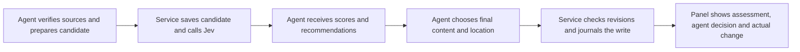

# Agent → Jev → agent → Brain

Date: 2026-11-02
Status: Proposed implementation design; no implementation started.

## Intent

Restore Jev's real write assessment as useful feedback in the writing agent's own session. The agent submits a sourced candidate, reads Jev's assessment, then writes the final note to the appropriate place. Every stage is inspectable and changes can be undone without overwriting later edits. Any authorized MCP client can perform the workflow.

Wilson selected this flow after rejecting model-held writes and considering an unattended maintenance service. Jev supplies judgment; the agent verifies sources, authors prose, selects destinations, and acts. The service validates and records those actions. An assessment is never permission or a required human approval.

## Current implementation

Baseline: `f811f2d` in the direct-write worktree. Ordinary `remember` writes currently bypass Jev entirely. `promote` still contains a model gate. `JevReview` exists but is collapsed in operation details. SQLite already stores write history and shared work; writes use revision checks and a recoverable journal. These are the starting points, not a new storage platform.

## Approaches

- A model gate before saving caused the reported Singapore consolidation to remain unsaved. Rejected: uncertain or duplicate scores must not strand an authorized agent.
- An Inbox followed by a scheduled maintainer separates capture from filing and introduces a second actor. Wilson chose to keep reasoning and filing in the active agent instead.
- **Selected: synchronous assessment, agent decision, explicit commit.** Normal capture goes directly to its final destination. No new cron job, mandatory Inbox, dedicated maintainer, or backend text-generating agent.

## Constraints

- Node >=24; reuse TypeScript, Zod, SQLite, React, the existing Jev client, write journal and work queue. Add no runtime dependencies.
- Jev scores are advisory. Only deterministic permission, privacy, path, claim, revision and recovery checks can prevent an otherwise requested commit.
- Preserve source/privacy boundaries, protected paths, enabled write scopes and existing collectors. Never turn an MCP rejection into a filesystem bypass.
- Any authorized agent can submit, inspect and resume work; no named-agent dependency or new schedule.
- Keep legacy direct `remember` callers working, with an honest “Not assessed” display. Updated capture instructions use assessment first.
- Use at most 20 additional paid Jev HTTP requests for this workflow's validation, counting failures and retries. The old exhausted allowance stays untouched.
- Server writes and device sync are separate outcomes. Do not promise zero latency or zero future maintenance.

## Normal flow

1. The agent searches and inspects relevant notes, original evidence and the parent hub. It proposes a destination and exact Markdown with sources. Inbox is optional for genuinely unresolved material under owner policy, not an intermediate step.
2. `assess_memory` saves that candidate and the precise eligible context supplied to Jev, then returns the real result synchronously. It does not write Markdown. No score creates a human-review hold.
3. The agent evaluates the response. It may keep the candidate, revise it, merge into an existing note, or record a reason for making no change. High overlap can support consolidation; it does not automatically mean “discard.”
4. `remember` commits the agent's final content and records its assessment reference and short decision reason. It checks the current file revision, not an old model verdict. `promote` uses the same advisory contract for existing Inbox moves while retaining structural/source checks.
5. The agent inspects the saved note. Any authorized immediate-parent hub update is a separate revision-checked operation linked to the same assessment. Report the note and hub outcomes separately; a partial sequence is resumable, not an all-or-nothing transaction.

The user-approved behavior is the flow above. The API and storage details below are implementation proposals chosen to reuse the current code.

## API and durable records

Add `assess_memory` with the existing sourced candidate fields (`path`, `markdown`, `sources`, `expectedRevision`, `idempotencyKey`), `intent: capture | consolidate | promote`, and optional `contextPaths` (at most five distinct existing notes). For promotion, require `sourcePath`; `expectedRevision` then refers to that source, matching the existing promotion contract. The candidate destination must be absent. Capture/consolidation use destination revisions normally. Require at least one nonempty verified source excerpt for assessment; a URL alone is not evidence. The service never fetches source URLs itself.

Validate paths, note privacy and revisions before any paid request. Context is the current/source note plus at most five eligible related notes, prioritizing explicit context paths. Store the exact bounded model inputs, their full-note revision identifiers, and truncation flags. Excluded explicit context fails locally with an actionable reason; excluded automatic neighbors are omitted. Source excerpts inherit the existing agent responsibility to verify source ownership and eligibility under owner policy. The service cannot independently establish the confidentiality of arbitrary external excerpts from the current `Source` fields; do not imply that it can. Do not add a new privacy attestation system or remotely fetch unknown origins in this change.

Add an `assessments` SQLite table using the existing JSON-payload pattern. An `Assessment` contains ID, actor/time, validated input, candidate fingerprint, model-input snapshots, `status: assessing | assessed | unavailable`, real `Decision`, structured recommendations, and a sanitized failure reason when needed. Once terminal, its input/result is immutable. A separate completion link records the final operation or no-change resolution; never replace the candidate with revised final content.

Reuse work claims: each assessment creates a work item of kind `assessment`, automatically claimed for five minutes by its submitting actor. Return `{assessment, workId, claimToken}`; keep tokens out of snapshots and other clients' inspection. Existing claim renewal rules apply: an expired claim must be reclaimed. Extend `inspect` with `assessmentId` and `list_work` with this kind. A same-client, same-payload request can recover its current token and stored result; it must not silently reclaim work from another client.

Extend `RememberInput` and `promote` with optional `assessment: {id, claimToken, reason}`. All three are required together. The ordinary path resolves and closes that assessment's work with the resulting applied operation, or an exact-content no-op. A failed commit leaves it resumable. `finish_work` can close an assessment with a no-change reason. Existing direct writes and legacy held proposals remain compatible and never trigger an implicit Jev call.

One assessment can have only one primary completion. Subsequent parent-hub writes use `relatedAssessmentId` for provenance without presenting the parent's content as assessed. Idempotent replay of a completed primary write returns its original operation; a competing new completion cannot write a second note. Correction after failure uses a new write key; its earlier failed operation remains in history.

`Operation.assessment` records the assessment ID, agent reason, and whether the final candidate matches the assessed candidate. Compare path, Markdown, sources, revision and promotion source identity, excluding retry keys. Record changed context revisions separately. A changed draft or context does **not** require another Jev request: the panel labels the result “Assessment of earlier draft/context.” The agent can explicitly obtain a fresh assessment, but there is no compulsory reassessment loop. The final content's provenance must be valid independently.

## What Jev returns

Retain the current real measures: worth remembering, evidence support, already remembered, and conflict/lost-context risk, together with model/version and usage. Describe “already remembered” as information overlap, not a calibrated probability that a write should be rejected.

Add a bounded structured advisory question set alongside the existing quality assessment. Candidate advice is `save | revise | merge | skip | investigate`; context-note advice is `keep | merge | promote | archive | delete | investigate`. Context advice can reference only supplied path/revision pairs. Include the chosen class, confidence and full validated probability distribution; use rubric descriptions for explanatory labels instead of inventing model prose. Batch the context questions in one request, not one request per note. Promotion advice is meaningful only for supplied Inbox notes. Consolidation intent must distinguish useful organization from new factual information.

Archive means retain historical/provenance value outside the active scope. Delete recommendations require evidence of redundancy and no unique source value; unresolved or truncated context yields investigation rather than a confident destructive recommendation. The agent independently checks references and remaining unique information. These are suggestions, never automatic mutations or grants of authority.

Folder selection remains the agent's job. Prefer an existing scope-specific destination. A new folder or broader reorganization is a distinct policy decision; this implementation does not silently broaden current capture permissions. Do not introduce generic delete/archive/folder tools as part of restoring the assessment flow.

## Failure, retries and resumption

- Persist `assessing` before calling Jev, release the vault write lock during network calls, then persist the result under the lock. Keep filesystem synchronization serialized as today.
- Exact retry keys/payloads return the same assessment without another model request. Concurrent duplicates see `assessing`; they do not launch another request. A changed payload with a reused key is an error.
- A timeout, malformed result or missing model configuration produces durable `unavailable`, without fabricated scores. On restart, abandoned `assessing` records become `unavailable` with an interruption reason. The agent may commit with a recorded reason, or explicitly retry assessment with a new key.
- If source/current revisions change during assessment, retain the genuine assessment of its captured context. At commit, existing write revision checks still apply. Changed comparison context is disclosed; a model result is never evidence that the latest context was read.
- If the agent stops, another authorized agent finds, claims and inspects the assessment, rechecks sources/revisions and resumes. No automatic schedule or worker is required. Deferring a claim records why work remains; abandoned leases expire normally.
- Link a pending write to its assessment before filesystem mutation. Recovery completes the same operation and closes the assessment work only after an applied or exact-no-op outcome. A crash must not leave an applied write eligible for another primary commit.

## Reversibility

Add narrow `undo_memory(operationId, expectedRevision, reason, idempotencyKey)` support for applied journaled writes and promotions. Undo records a new compensating operation linked through `Operation.undo.operationId`; the original remains intact. Repeating the request returns that same undo. No Jev call is needed. The original write scope (`new`, `update` or `promote`) must still be enabled. Within the current single-owner authorization model, an authenticated MCP invocation requests this bounded inverse; the portable skill requires an explicit owner undo request or already-authorized reversal task. There is no new owner-only token or general deletion permission. The browser owner's explicit Undo action follows the same checks.

For an update, restore recorded `before` only if the current revision is the recorded result. For a create, remove only the exact created revision after checking incoming links; for a promotion, restore the exact original source only if the destination is unchanged, the source is absent, and resolved links remain valid. Journal removals and moves with recoverable progress. A later edit, path reuse or changed link dependency prevents automatic undo and produces a concrete explanation. Never recursively delete a folder or revert unrelated operations. An explicitly requested undo authorizes only that bounded inverse; new delete recommendations do not authorize it.

The operation history shows note and hub changes independently. To reverse a compound capture, undo dependent hub links before undoing the note. One original operation has at most one successful inverse. Undo-of-undo/redo, broad multi-file atomic transactions and automatic cascading rollback are out of scope; a later intentional reapplication is a new sourced write.

## Write-assessment panel

Restore the prominent `JevReview` panel in operation details. It shows the submitted candidate, actual assessment and recommendations, agent response, final changed content, and actual commit outcome. For changed drafts/context, label what the scores evaluated. Show “Not assessed” for legacy writes and “Assessment unavailable” for failed assessment attempts. Never generate replacement scores or label samples as live.

The work list labels staged candidates “Awaiting agent,” with a visible assessment detail; it must not imply a note was saved or that a person must approve it. Applied status takes precedence over classifications such as `not_worth_remembering`. Provide an explicit owner Undo action for supported operations, with reason and current-revision checks; errors explain why the existing note was preserved.

## Acceptance

- A synthetic Singapore-style consolidation receives high overlap advice, returns to the agent, and is written directly with sources and originals preserved.
- A revised candidate is saved with an honest earlier-draft assessment label and the agent's rationale; no second judge is forced at commit.
- Two different authorized MCP clients can hand off an interrupted assessment without duplicate writes or token leakage.
- Unavailable Jev, exact retries, stale files, private context, changed claim ownership and restart recovery each have deterministic tests.
- Create/update/promotion undo survives retries/restarts and refuses later edits or broken links.
- The real panel is visible in the browser and demo samples remain explicitly illustrative.
- Updated shared skills, tool documentation and affected owner workflow routing describe the same agent-agnostic flow; existing unrelated schedules and local privacy routes remain intact.

Quality feedback on each write reduces capture cleanup. It does not automatically inspect every external edit, revisit old facts, or eliminate all maintenance. No deployment, policy rewrite, vault mutation or live Jev request is part of producing this design and its plan.
